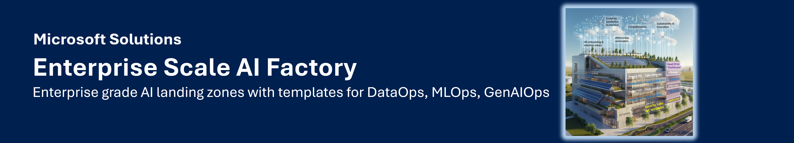
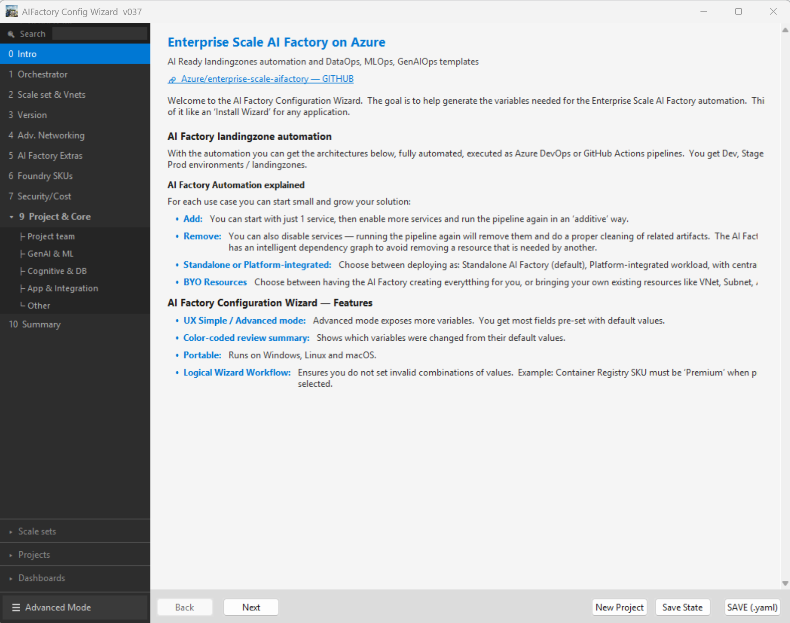
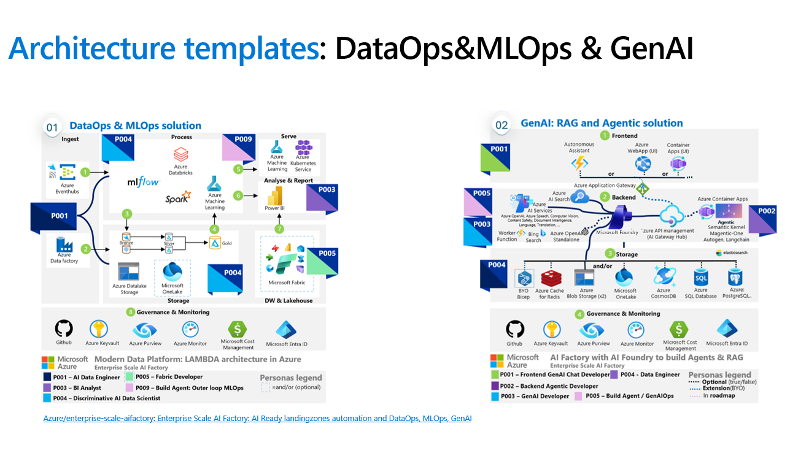
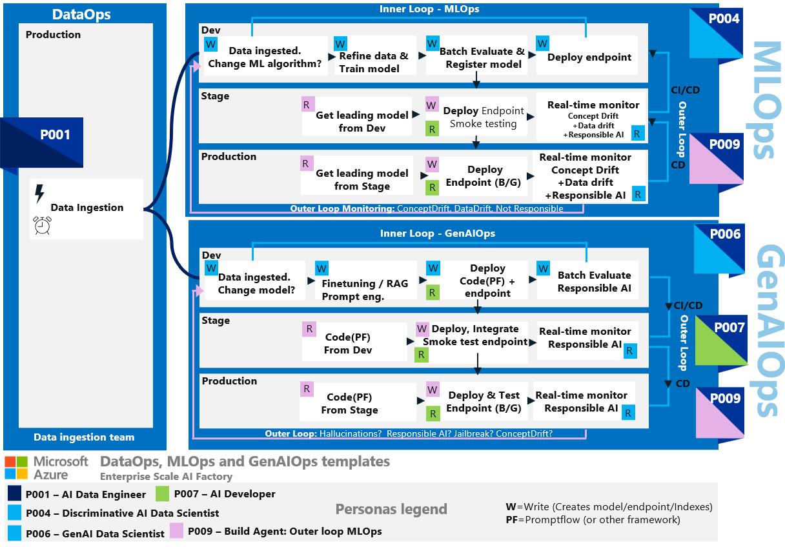
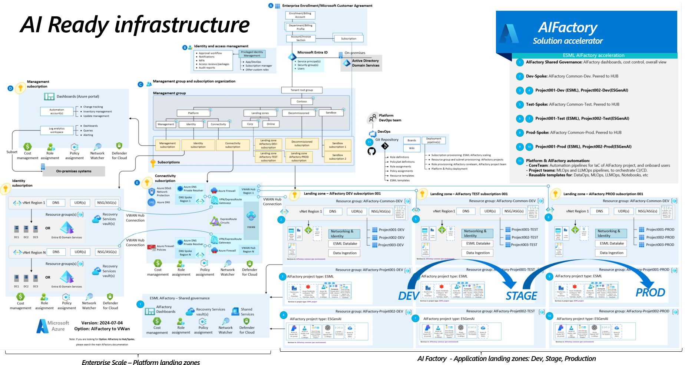

# Enterprise Scale AI Factory - Template repo



Welcome to the official Enterprise Scale AIFactory solution accelerator template.

## What is the AI Factory?[¶](https://jostrm.github.io/azure-enterprise-scale-ml/#what-is-the-ai-factory)
The **Enterprise Scale AI Factory** is a plug-and-play solution that automates the provisioning, deployment, and management of AI projects on Azure using a template-driven approach.

- **AI-ready landing zones** with templates for DataOps, MLOps, and GenAIOps.
- **Automatically deploys 1–35 Azure services** in a WAF-aligned application landing zone. It supports the full AI spectrum — generative AI, deep learning, machine learning, and traditional application development: AI Foundry, Azure Machine Learning, Databricks, AI Search, AKS, Logic Apps, Container Apps, Azure Functions, PostgreSQL, SQL Database, and more.
- **Add or remove services** at any time via feature flags — all wired up with private networking, RBAC, and monitoring automatically is created or cleaned up when removing resource.
- Supports both **GitHub Actions** and **Azure DevOps** as orchestrators.

> [!NOTE]
> Since the Well-Architected Framework does not recommend using Azure Developer CLI (`azd`) for production, this project uses GA `Azure CLI` with orchestrator pipelines in GitHub Actions or Azure DevOps Pipelines.

---

## Main Purpose[¶](https://jostrm.github.io/azure-enterprise-scale-ml/#main-purpose)

1. **Marry multiple best practices**: Secure Enterprise Scale AI Landing Zones + Secure GenAIOps/MLOps templates — GenAIOps templates built on unsecured infrastructure are incompatible with private-endpoint-based infra, so the two are designed together here.
2. **Plug-and-play**: Dynamically creates infra resources per team, including subnet/IP calculation, private networking, RBAC, and ACL permissions on the data lake — fully automated.
3. **Template-based project delivery**: Project-based structure (cost control, privacy, scalability) with ready-made templates for DataLake, DataOps, MLOps, and GenAIOps.
4. **Enterprise scale, security, and battle-tested**: Used by customers and partners with MLOps and GenAIOps since 2019.
5. **Intelligent CRUD for 30+ Azure resources**: Enable and disable feature flags to add or safely remove resources. The AI Factory's internal dependency graph ensures that services are created, updated, and deleted in the correct order — including proper cleanup — without breaking dependent resources.
6. **Turn-key Enterprise Scale Data Lake with Datamesh**: A structured, permission-layered data lake is provisioned automatically, with per-project ACL isolation and Datamesh-ready design, to marry data management with AI workloads.
7. **Flexible with 10+ BYO concepts**: Bring Your Own IaC (Bicep, Terraform, ARM) on top of the AI Factory pipelines; BYO networking (VNet, subnets, routing tables); BYO Data Lake; BYO App Service Environment; BYO encryption key (CMK) — all configurable via a handful of parameters.

---

## AI factory AI Application Landingzones: CONCEPTS & DESIGN: Differentiators?[¶](https://jostrm.github.io/azure-enterprise-scale-ml/#ai-factory-ai-application-landingzones-concepts-design-differentiators)

- The AI Factory wraps multiple environments together: Dev, Stage, Prod, per team, called `AI Factory project`.
- The AI Factory sets up 1 to 3 AI Application Landing Zones per `AI Factory project` and `project team` (a team assigned to a project)
- The AI Factory scales with Azure Subscriptions, called `AI Factory scale sets`, each team their own scaleset (3 Subscriptions = Application Landingzones)
- Each AI Factory project (landingzone) is divided in two parts: COMMON & PROJECT specific, on resource group level - since required to align with WAF & CAF:
  - `WAF Cost optimization`: Reuse networking and common artifacts, across services in an architecture used by the `use case` and team
  - `WAF Security`: `Least privileged access` since the end-users does not need to have access on certain networking resources and other artifacts. `Granular security`
  - `Operations`: `Reusing` common artifacts also makes it easier to operate, such as `Centralized Monitoring & Logging`, `Common security` separated from granular `Role Specific Access`.
- See full [Documentation](https://github.com/jostrm/azure-enterprise-scale-ml/blob/main/documentation/v2/10_index.md) for more info

- The AI Factory is designed, with its own compatible TEMPLATES for DataOps, MLOps, GenAIOps ( to avoid the challenges of incompatible security, etc)
- Each `AI Factory project` can `add or remove +34 Azure services` - e.g. Not only the GenAI part of a solution, but also to avoid the challenges of incompatible security with ease and full automation of creating an End-2-End solution with 100% private networking for:
  - Full AI: Both GenAI (Foundry) and Machine Learning (Azure Machine Learning, Azure Databricks)
  - Front-End (UI, Caching)
  - Back-End (Databases)
  - Integration (LogicApps, APIM, Eventhubs)
  - Soveregnity: On-premises link via Azure Arc to Azure Machine Learning, Kubernetes, for Sovereign Cloud purposes.

---

This is a template repository, bootstrapped with the *Enterprise Scale AIFactory submodule* (the most common way of leveraging the AIFactory template acceleration)

This repo will leverages resources/templates from the [`Enterprise Scale AI Factory submodule`](https://github.com/jostrm/azure-enterprise-scale-ml/) including templates for `IaC AI landingzones, DataOps, MLOps, GenAIOps`.

The mirror repo based on this repo, will act as your repo with options as: [Github private, internal, public repo](https://resources.github.com/learn/pathways/administration-governance/essentials/manage-your-repository-visibility-rules-and-settings/), or a [private or public Azure Devops repository](https://learn.microsoft.com/en-us/azure/devops/organizations/projects/make-project-public?view=azure-devops)

[Quickstart Documentation - Setup | Parameters](https://jostrm.github.io/azure-enterprise-scale-ml/)

>[!NOTE]
>Since the mirror repo will become your repo (or see BYORepo option), you will not have any failure with tokens/cross-authentication.
>

## The purpose of this repo
This repo, is purposed to bootstrap a repository, that automatically links to the centralized (readonly)submodule `azure-enterprise-scale-ml`, and provides you with templates for YOUR variables, to customize your AI Factory, besides the basic [.env.template](./.env.template) parameters that will end up as Variables in your Github/Azure Devops.

It also provides an automation script to copy templates IaC automation variables and other templates for [DataOps, MLOps, GenAIOps - Read more](https://github.com/jostrm/azure-enterprise-scale-ml/).<br>

## Simple mode VS Advanced mode
This repo is the *simple mode* to setup an AIFactory. This contains automation to:
- Automate the [full manual AIFactory setup process seen here](https://github.com/jostrm/azure-enterprise-scale-ml/blob/main/documentation/v2/10-19/13-setup-aifactory.md). Estimated time effort for manual setup is 2h, and is reduced to 10min with this repo.
- Set default values for all 30 [AIFactory based parameters seen here](https://github.com/jostrm/azure-enterprise-scale-ml/blob/main/documentation/v2/10-19/13-parameters-ado.md), saving you estimated time effort of 1h.

The ESML AIFactory with manual setup is said to accelerate setup from 500-1500h down to ~4h setup time.<br>
This repo accelerates even further, below 1h, since leaving only a hand-full of variables to setup in [.env.template](./.env.template)
-> Making it a good choice to quickly setup infrastructure securely for AI-hackathons, workshops, education - scenarios where you are OK if naming convention does not comply 100% with your organizations choices, and you don't need to peer it to your Hub - e.g. where `AIFactory standalone mode` is OK.

> [!NOTE]
> For easy setup, use the [AI Factory Configuration Wizard](https://github.com/jostrm/azure-enterprise-scale-ml/blob/main/environment_setup/install_config_wizard/readme.md) Setup in minutes, intelligent workflow-drivern setup Wizard.
>

> [!IMPORTANT]
>This repo provides a ready-to-run github repo, bootstrapped and connected to the *Enterprise Scale AI Factory Github submodule*. For full documentation visit the documentation section [`Enterprise Scale AI Factory submodule`](https://github.com/jostrm/azure-enterprise-scale-ml/blob/main/documentation/readme.md)
>

## Setup options - GITHUB
As a mirror-repo (Github) or "Bring your own repo" (Github or Azure Devops) <br>

After you have copied the  [.env.template](./.env.template) as your [.env](./.env) file, you have the options below.

- A) Bootstrap as a mirror-repo in Github, it becomes a private, internal or public Github repo
    - **When to choose**: If you are allowed to create own repos, and Github is your preferred choice.
    - **Automation scripts to run**:  [Bootstrapping a new AIFactory](documentation/bootstrapping.md), or do quickstart: 
    - **Quickstart:**
        - 1) [01a-GH-mirror-repo-from-template-once.sh](./01a-GH-mirror-repo-from-template-once.sh)
        - 2) VS code open up a new Window with your new repo - Rename `.env.template` to `.env` and edit it. 
            - Edit the PARAMETER folder also. 
        - 3) Go to Github.com to your repo, and edit the secret: `AZURE_CREDENTIALS` - it should be formatted as follows:
               ```json
                {
                    "clientId": "your-client-id-aka-appId",
                    "clientSecret": "your-client-secret-aka-servicePrincipalSecret",
                    "subscriptionId": "your-subscription-id",
                    "tenantId": "your-tenant-id"
                }
                ```
        - 4) Run at least 2 Github Actions workflows at Github.com | or: [04ab-setup-infra-aifactory.sh](./04ab-setup-infra-aifactory.sh)
            - infra-common.yaml
            - infra-project-genai.yaml
- B) Bring your own "empty" repo 
    - **When to choose**: If your organization don't allow you to create repos, or if you prefer Azure Devops.
    - **Automation scripts to run**: See full instructions here:  [Bootstrapping a new AIFactory](documentation/bootstrapping.md)
- C) AI Factory configuration wizard: A small Python application you install locally, to have a Wizard experience (Supported on Win, Mac, Linux)



## Setup options - Azure Devops
Please visit the full documentation for here. [Enterprise Scale AI Factory - Setup](https://github.com/jostrm/azure-enterprise-scale-ml/blob/main/documentation/v2/20-29/24-end-2-end-setup.md)

> [!NOTE]
>   
> The steps A and B above will create pipelines in Azure Devops or Github (as GHA workflows), and the pipelines will setup the AIFactory and AI Factory projects. Before you start you will need configure your [.env](./.env) environment variables. Read more at [bootstrapping.md](./documentation/bootstrapping.md) section.
>

## How to create more projects of different types? 
As explained in previous section you will end up with automation pipelines, in either your own Azure Devops (as Release pipelines) or your own Github repositories (as Actions/Workflows).
You can have 1 or 26 Azure PaaS resources, simply *enable* them in Variables.yaml or .env for Github, or use the AI Factory configuration wizard with checkboxes.

The pipelines, can be executed multiple times, to provision multiple AIFactory projects. 
You only need to change a few parameters in the .env file, and run [02b-GH-create-or-update-github-variables.sh](./02b-GH-create-or-update-github-variables.sh) - values such as below:
```python

PROJECT_NUMBER="001" # <XXX> unique string per aifactory, usually 001,002,003
PROJECT_MEMBERS="qwer123-qwer-wrfe-23fd-asdfqewrt,asdfg-qwer-asdf-23fd-asdf1234" #[GH-Secret] ObjectID in a commas separated list, without space
ENABLE_AI_SEARCH="true"
ENABLE_AZURE_MACHINE_LEARNING="true"

...


```


For full documentation, please visit [`Enterprise Scale AI Factory documentation`](https://github.com/jostrm/azure-enterprise-scale-ml/blob/main/documentation/readme.md)
## Feature Highlights

- Bootstrap your project in under an hour, including enterprise grade security
- Enterprise grade security and networking (private link).
- Provision resources with IaC (BICEP)
- Automate IaC with (Github Actions or Azure Devops)
- Easy-to-configure and extend templates: DataOps, MLOps, GenAIOps
- Aligned with Well-Architected Framework and Cloud Adoption Framework
- AI Factory project types:
    - **GenAI**: GenAI: Azure AI Foundry with RAG using Azure AI Search
    - **ESML**: DataOps and MLOps with notebooks templates - both Databricks (Pyspark) and Jupyter notebooks(Python). Mix compute & tech, while using same MLOps pipeline

### Project Types (IaC templates) - Well-architected Framework


### DataOps, MLOps, GenAIOps (templates) - Well-architected Framework
[Read more: Well-Architected Framework AI workload](aka.ms/wafai)



### Enterprise Scale: AI Ready landingzones - Cloud Adoption Framework
[Read more: AI Factory in CAF](https://learn.microsoft.com/en-us/azure/cloud-adoption-framework/ready/azure-best-practices/ai-machine-learning-mlops?source=docs)



> [!NOTE]
>**Enterprise security**: Both fully private mode (private link for also the Azure AI Studio) or private link with AI Studio accessible from certain IP. Role-based access control is used, meaning EntraID for all sercice-to-servcice and user-to-service connections. Not using any keys (since global keys have full permission to services, it is not recommended)
>

[Full documentation -  "Enterprise Scale AI Factory"](https://github.com/jostrm/azure-enterprise-scale-ml/blob/main/documentation/readme.md)

## How-to

1. [Bootstrapping a new AIFactory](documentation/bootstrapping.md)
2. [Bootstrapping a new AIFactory project (Type: genai-1 or ESML)](documentation/bootstrapping.md)
3. [Delivering a new Feature: CI/CD with MLOps or GenAIOps](documentation/delivering_new_feature.md)

## Contributing

This project welcomes contributions and suggestions.  Most contributions require you to agree to a
Contributor License Agreement (CLA) declaring that you have the right to, and actually do, grant us
the rights to use your contribution. For details, visit https://cla.opensource.microsoft.com.

When you submit a pull request, a CLA bot will automatically determine whether you need to provide
a CLA and decorate the PR appropriately (e.g., status check, comment). Simply follow the instructions
provided by the bot. You will only need to do this once across all repos using our CLA.

This project has adopted the [Microsoft Open Source Code of Conduct](https://opensource.microsoft.com/codeofconduct/).
For more information see the [Code of Conduct FAQ](https://opensource.microsoft.com/codeofconduct/faq/) or
contact [opencode@microsoft.com](mailto:opencode@microsoft.com) with any additional questions or comments.

## Trademarks

This project may contain trademarks or logos for projects, products, or services. Authorized use of Microsoft 
trademarks or logos is subject to and must follow 
[Microsoft's Trademark & Brand Guidelines](https://www.microsoft.com/en-us/legal/intellectualproperty/trademarks/usage/general).
Use of Microsoft trademarks or logos in modified versions of this project must not cause confusion or imply Microsoft sponsorship.
Any use of third-party trademarks or logos are subject to those third-party's policies.
